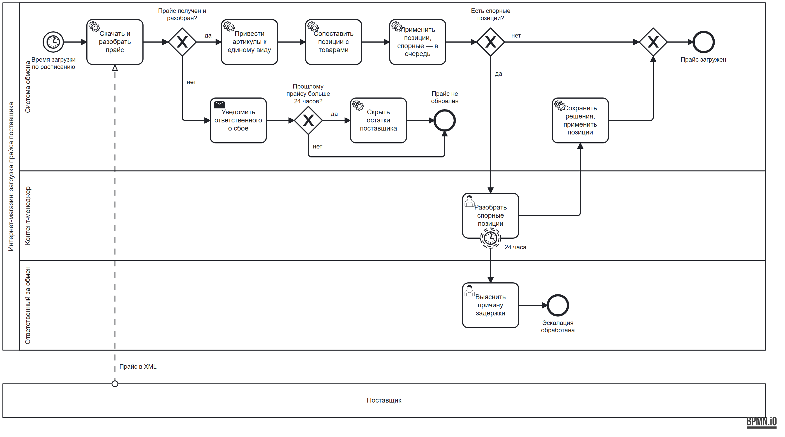

# Портфолио системного аналитика

Максим Макаров · Telegram [@programbaze](https://t.me/programbaze)

Примеры аналитических документов. Они основаны на моём опыте интеграции интернет-магазина на 1С-Битрикс (каталог более 1 млн позиций) с 1С и прайсами поставщиков. Названия, цифры и поля упрощены.

## Документы

| Документ | Что показывает | Файлы |
| --- | --- | --- |
| ТЗ: обмен товарами, ценами и остатками с 1С | Цели и границы, функциональные и нефункциональные требования, модель данных, REST API с примерами, обработка ошибок, критерии приёмки, открытые вопросы | [Markdown](tz-1c-exchange/tz-1c-exchange.md) · [PDF](tz-1c-exchange/tz-1c-exchange.pdf) |
| BPMN: загрузка прайса поставщика | Пул и дорожки, таймерные события, неинтерруптивный таймер с эскалацией, поток сообщений с внешним участником | [BPMN](bpmn/price-list-loading.bpmn) · [PNG](bpmn/price-list-loading.png) |

## BPMN: загрузка прайса поставщика

Файл `.bpmn` открывается в [Camunda Modeler](https://camunda.com/download/modeler/) или на [demo.bpmn.io](https://demo.bpmn.io/).
