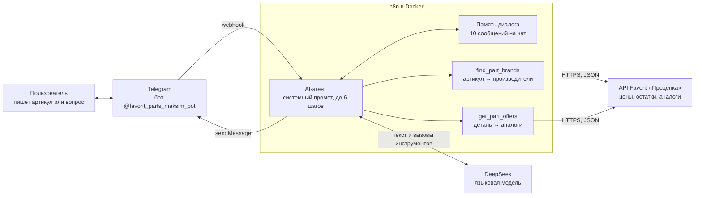
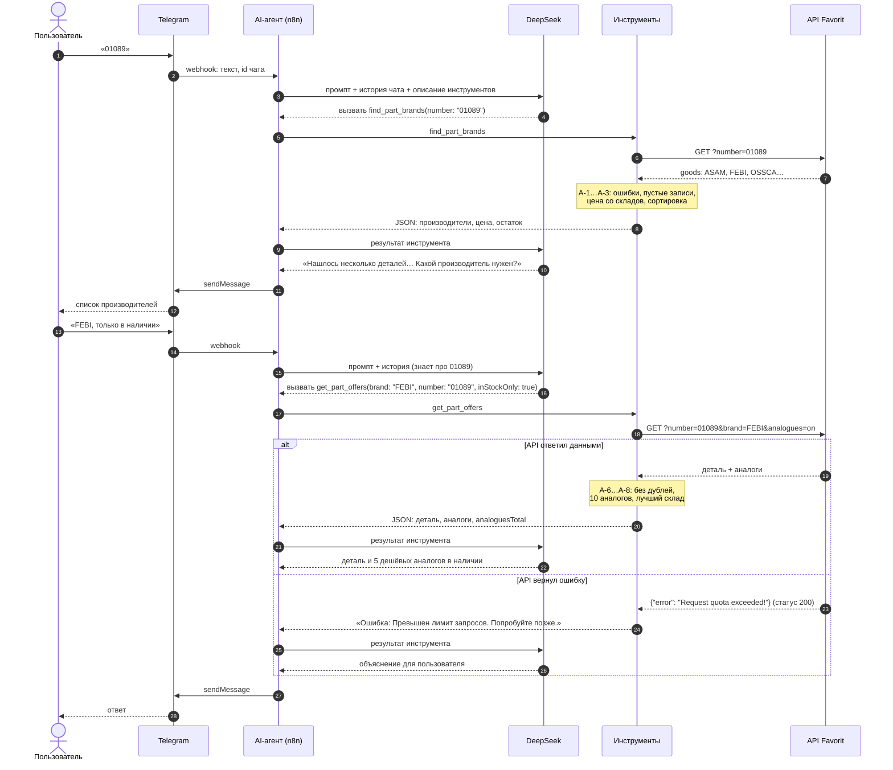

# Требования: AI-агент для подбора автозапчастей через API поставщика

28.10.2026 · Максим Макаров

Аналитическая часть проекта [favorit-parts-search](https://github.com/programbaze-collab/favorit-parts-search): поиск запчастей и аналогов через API поставщика Favorit в трёх каналах — сайт, MCP-сервер для AI-агентов и Telegram-бот на n8n. Документ описывает Telegram-бота, но особенности API и правила обработки данных из раздела 4 общие для всех трёх каналов.

## 1. Цель и границы

**Цель:** покупатель или менеджер пишет в Telegram артикул или вопрос своими словами и за несколько секунд получает реальные цены, остатки, сроки отгрузки и аналоги — без захода на сайт и без звонка менеджеру.

**Что входит:**

- поиск производителей по артикулу;
- подбор аналогов с фильтром «только в наличии»;
- уточняющий диалог: агент помнит, о какой детали шла речь;
- понятные сообщения, если ничего не найдено или API недоступен.

**Что не входит:** оформление заказа, оплата, подбор по VIN или марке автомобиля, авторизация покупателей и персональные цены. Это отдельные задачи.

**Термины**

| Термин | Что значит |
| --- | --- |
| Артикул | Номер детали у производителя. Один артикул бывает у разных производителей и обозначает разные детали |
| Производитель (brand) | Бренд детали: FEBI, ASAM, GLASER |
| Аналог | Деталь другого производителя, которая заменяет искомую |
| Склад | Место, откуда отгружается деталь. У позиции может быть несколько складов с разной ценой |
| Отгрузка | Поле `shipmentDate`: дата — день отгрузки, время — до скольких нужно заказать |
| Инструмент агента | Функция, которую AI-агент вызывает сам, чтобы получить данные. Здесь — запросы к API Favorit |
| Память диалога | Последние сообщения чата, которые агент видит при ответе |

## 2. Участники и системы

| Участник | Роль |
| --- | --- |
| Пользователь | Покупатель или менеджер магазина. Пишет свободным текстом |
| Telegram | Канал общения. Передаёт сообщения в n8n через webhook |
| n8n | Оркестратор: принимает сообщение, запускает агента, отправляет ответ |
| AI-агент | Решает, какие инструменты вызвать и как сформулировать ответ |
| DeepSeek | Языковая модель, на которой работает агент |
| API Favorit | Источник данных. Единственный источник цен и остатков |

## 3. Сценарии использования

### UC-1. Поиск по артикулу

**Основной поток**

1. Пользователь отправляет артикул, например `01089`.
2. Агент вызывает `find_part_brands` с этим артикулом.
3. API возвращает производителей: по `01089` это ASAM (топливный фильтр), FEBI (антифриз), OSSCA (стеклоподъёмник) и другие.
4. Агент перечисляет производителей с наименованием, минимальной ценой и остатком и спрашивает, какой нужен.

**Альтернативные потоки**

| Условие | Что делает агент |
| --- | --- |
| Производитель один или назван в сообщении | Сразу переходит к UC-2 |
| Ничего не найдено | Сообщает, что по артикулу ничего не найдено, и предлагает проверить номер |
| Артикул короче 3 символов | Инструмент отказывает без запроса к API, агент просит полный артикул |
| В сообщении нет артикула («нужны колодки») | Просит прислать артикул |
| Ошибка API или нет связи | Пересказывает причину своими словами: «превышен лимит запросов, попробуйте позже» |

### UC-2. Подбор аналогов

**Основной поток**

1. Пользователь выбирает производителя («FEBI») или сразу пишет «аналог антифриза FEBI 01089, только в наличии».
2. Агент вызывает `get_part_offers` с производителем и номером **из ответа `find_part_brands`**.
3. Агент показывает искомую деталь и до пяти самых дешёвых аналогов в наличии: цена, склад, остаток, дата отгрузки.
4. Если аналогов больше, сообщает общее число и предлагает уточнить: цвет, объём, производитель.

**Альтернативные потоки**

| Условие | Что делает агент |
| --- | --- |
| Просят «в наличии», «что можно купить сейчас» | Передаёт `inStockOnly: true` |
| Аналогов нет | Показывает только искомую деталь и говорит, что аналогов не найдено |
| Нет в наличии ни одной позиции | Сообщает об этом, не выдумывая сроков поставки |

### UC-3. Уточнение в диалоге

Пользователь продолжает разговор без повторения артикула: «а FEBI?», «а подешевле?». Агент берёт контекст из памяти диалога. У каждого чата Telegram своя память, разговоры разных пользователей не смешиваются.

## 4. Особенности API и правила обработки

Особенности найдены при разборе документации и реальных ответов API. Каждая из них ломает «наивную» интеграцию, поэтому для каждой есть правило и автотест.

| № | Особенность API | Что сломается без правила | Правило |
| --- | --- | --- | --- |
| A-1 | Ошибка приходит как `{"error": "..."}` — иногда со статусом 200, иногда 403 | Ошибку примут за пустой ответ: «ничего не найдено» вместо «превышен лимит» | Сначала проверять поле `error` в теле, потом статус |
| A-2 | «Не найдено» — массив с одной записью, где `goodsID` из нулей и пустой `brand` | Пользователь увидит пустую строку без названия и цены | Такие записи отбрасывать |
| A-3 | Корневое поле `price` устарело, в нём бывает неактуальная цена | Покажут неверную цену | Цену брать со складов: минимальная среди складов с остатком и ценой больше нуля |
| A-4 | Номер детали у производителя отличается от введённого: по `01089` находится GLASER `H01089-00` | Запрос аналогов с введённым номером ничего не вернёт | Для второго запроса брать номер из ответа первого |
| A-5 | Один артикул у разных производителей — это разные детали | Агент покажет аналоги не той детали | Если производителей несколько, спросить пользователя |
| A-6 | В списке аналогов бывают дубли и сама искомая деталь | Одна позиция покажется дважды | Убирать дубли по `goodsID` и исключать искомую деталь |
| A-7 | Аналогов бывают сотни: у антифриза FEBI 01089 их больше ста | Ответ не поместится в контекст модели и в сообщение Telegram | Отдавать агенту не больше 10 аналогов и общее число `analoguesTotal` |
| A-8 | Складов у позиции бывает десятки | То же, что в A-7 | Агенту отдавать только лучший склад: самый дешёвый с остатком, при равной цене — с ранней отгрузкой |
| A-9 | `shipmentDate` — не момент времени: дата — день отгрузки, время — срок заказа | При пересчёте в часовой пояс пользователя дата сдвинется | Разбирать строку как есть, без пересчёта |
| A-10 | Ответ сервера иногда не JSON (HTML страницы ошибки) | Падение при разборе | Сообщение «сервер вернул некорректный ответ» с кодом статуса |

Порядок выдачи — одинаковый во всех каналах: сначала позиции в наличии, среди них — дешёвые выше.

## 5. Диаграмма последовательности

Основной поток UC-1 → UC-2 и обработка ошибки API.

## 6. Контракт инструментов агента

Агент получает описание инструментов и сам решает, когда их вызвать. Описание — часть требований: по нему модель понимает порядок вызовов.

### find_part_brands

| Вход | Тип | Обязательный | Описание |
| --- | --- | --- | --- |
| `number` | строка | да | Артикул, не короче 3 символов. Пробелы по краям обрезаются |

**Выход:** `query` — артикул из запроса; `brands` — список производителей: `brand`, `number`, `name`, `stock`, `minPrice` (`null` — нет в наличии), `bestWarehouse` (код склада, цена, остаток, отгрузка). При ошибке — строка «Ошибка: …».

### get_part_offers

| Вход | Тип | Обязательный | Описание |
| --- | --- | --- | --- |
| `brand` | строка | да | Производитель из ответа `find_part_brands` |
| `number` | строка | да | Номер из ответа `find_part_brands`, а не из сообщения пользователя (A-4) |
| `inStockOnly` | логический | нет | Только позиции с остатком |

**Выход:** `original` — искомая деталь (`null`, если не найдена); `analogues` — до 10 аналогов; `analoguesTotal` — сколько аналогов найдено всего. При ошибке — строка «Ошибка: …».

## 7. Требования к поведению агента

Требования реализованы в системном промпте и в коде инструментов. Колонка «Где» показывает, что гарантирует код, а что — только промпт: требования из промпта модель может нарушить, их нужно проверять отдельно (раздел 9).

| № | Требование | Где |
| --- | --- | --- |
| ФТ-1 | Цены, остатки и сроки — только из ответов инструментов. Не придумывать и не округлять | Промпт |
| ФТ-2 | Если по артикулу несколько производителей, а пользователь не назвал нужного, — перечислить и спросить | Промпт |
| ФТ-3 | Для аналогов использовать производителя и номер из ответа `find_part_brands` | Промпт, описание инструмента |
| ФТ-4 | Показывать не больше пяти аналогов: самые дешёвые из тех, что в наличии | Промпт; код отдаёт не больше 10 |
| ФТ-5 | Ошибку инструмента пересказать пользователю своими словами | Промпт; код возвращает текст ошибки по-русски |
| ФТ-6 | Без артикула — попросить его прислать | Промпт |
| ФТ-7 | Артикул короче 3 символов не отправляется в API | Код |
| ФТ-8 | Отвечать по-русски, простым текстом без таблиц и Markdown: цена «1 082 ₽», дата «30.10» | Промпт |
| ФТ-9 | Не больше 6 шагов агента на одно сообщение, чтобы не уйти в бесконечный цикл вызовов | Настройка агента |

## 8. Нефункциональные требования

| № | Требование | Значение |
| --- | --- | --- |
| НФТ-1 | Таймаут запроса к API Favorit | 15 секунд, дальше — сообщение «нет связи с сервером» |
| НФТ-2 | Объём ответа инструмента | Не больше 10 аналогов и один склад на позицию (A-7, A-8) |
| НФТ-3 | Память диалога | 10 последних сообщений, отдельно для каждого чата |
| НФТ-4 | Детерминированность ответов | Температура модели 0,2 |
| НФТ-5 | Повторяемость развёртывания | n8n в Docker, сценарий хранится в git и собирается из кода инструментов |
| НФТ-6 | Секреты | Токен бота и ключ DeepSeek хранятся в учётных данных n8n, не в коде и не в git |

## 9. Критерии приёмки и как они проверены

| Критерий | Как проверено |
| --- | --- |
| Особенности API A-1…A-10 обрабатываются по правилам | Автотесты: `n8n/tools.test.js`, `src/api/normalize.test.js`, `src/api/favoritApi.test.js` |
| Инструменты возвращают производителей и аналоги в нужном порядке, с лимитом и общим числом | Автотесты `n8n/tools.test.js` |
| Код инструментов работает внутри n8n с реальным API | Запуск в n8n на живом API: производители по `01089`, аналоги FEBI в наличии, пустой ответ |
| Файл сценария соответствует коду инструментов, связи в сценарии корректны | Автотест `n8n/tools.test.js` |
| ФТ-1: цифры в ответе агента совпадают с API | Ручная сверка: цены и остатки FEBI 01089 и аналога Miles AFB1 в ответе бота совпали с ответом API |
| Пять диалогов: артикул, выбор производителя, всё одним сообщением, «не найдено», без артикула | Ручная проверка в Telegram |
| Те же правила в веб-интерфейсе и MCP-сервере | Автотесты Vitest и E2E на Playwright; всего больше 50, запускаются в CI при каждом изменении |

## 10. Риски и открытые вопросы

| Риск или вопрос | Предложение |
| --- | --- |
| Требования из промпта (ФТ-1, 2, 4, 6, 8) проверены вручную, модель может их нарушить после смены версии или промпта | Набор эталонных вопросов с ожидаемыми ответами и автоматическая проверка ответов агента перед каждым изменением промпта |
| Ключ API Favorit записан в коде инструментов (сейчас демо-ключ из документации) | Перенести в учётные данные n8n или переменные окружения |
| Лимит запросов API при росте числа пользователей | Кэшировать ответы по артикулу на несколько минут; узнать у Favorit лимиты для рабочего ключа |
| Память диалога хранится в оперативной памяти n8n и теряется при перезапуске | Для рабочей версии — хранить в Redis или Postgres |
| Бот доступен, пока работает компьютер с n8n и туннель | Развернуть n8n на сервере с постоянным адресом |
| Нужен ли переход к заказу: кнопка «Оформить» со ссылкой на сайт? | Решение за владельцем продукта |
