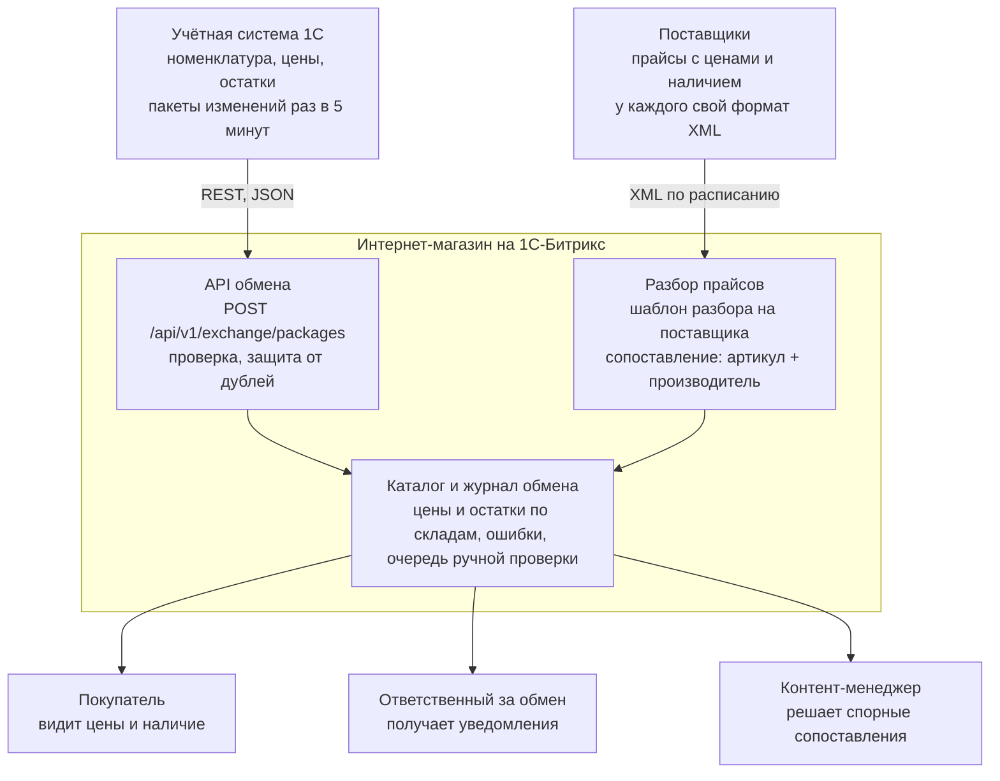
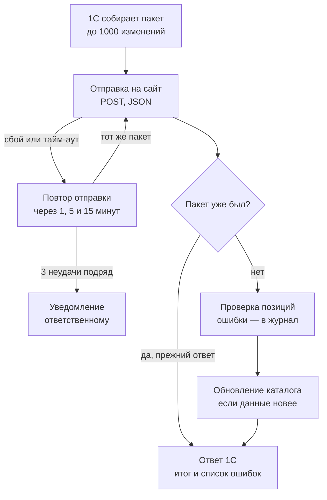

# ТЗ: обмен товарами, ценами и остатками между интернет-магазином и 1С

27.10.2026 · Максим Макаров

## 1. Общие сведения

Цель — чтобы цены и остатки на сайте совпадали с 1С не позже чем через 15 минут после изменения, без ручной работы контент-менеджера.

Документ описывает автоматический обмен данными между учётной системой 1С и интернет-магазином электротоваров на 1С-Битрикс с каталогом более 1 млн позиций.

**Что входит в задачу:**

- выгрузка из 1С на сайт: товары, цены, остатки по складам;
- загрузка прайсов поставщиков в XML и сопоставление их позиций с номенклатурой 1С;
- отчёт о расхождениях и ошибках обмена.

**Что не входит:** выгрузка заказов с сайта в 1С, оплата, доставка, личный кабинет покупателя. Это отдельные задачи.

**Термины**

| Термин | Что значит |
| --- | --- |
| Номенклатура | Справочник товаров в 1С, у каждого товара свой код |
| Артикул | Номер детали у производителя. У разных производителей артикулы могут совпадать |
| Остаток | Сколько единиц товара есть на конкретном складе |
| Прайс поставщика | XML-файл от поставщика с его товарами, ценами и наличием |
| Сопоставление | Связь позиции из прайса с товаром из номенклатуры 1С |
| Пакет обмена | Одна порция изменений, которую 1С передаёт сайту за раз |

## 2. Как сейчас и что не так

Сейчас остатки на сайте обновляются раз в сутки, а прайсы поставщиков загружаются вручную. Из-за этого покупатели заказывают товар, которого уже нет.

| Проблема | Чем плохо |
| --- | --- |
| Полная выгрузка из 1С идёт ночью, один раз в сутки | Днём остатки на сайте устаревают, часть заказов приходится отменять |
| Прайсы поставщиков загружает контент-менеджер вручную | Уходит несколько часов в день, часто бывают ошибки |
| У каждого поставщика своя структура XML | Нет единого способа её разобрать |
| Один и тот же артикул встречается у разных производителей | Позиции прайса привязываются к чужому товару |
| Нет отчёта об ошибках обмена | О сбое узнают от покупателей или менеджеров |

## 3. Участники и системы



1С и поставщики меняют каталог только через свои входы, а люди работают уже с каталогом и журналом. Источник правды по товарам и собственным складам — 1С.

## 4. Как будет идти обмен



Каждый пакет либо применяется один раз, либо ждёт повтора: потерять изменения или применить их дважды нельзя. Прайсы поставщиков проходят те же шаги проверки и обновления, но запускаются по расписанию сайта.

## 5. Функциональные требования

Система передаёт изменения из 1С на сайт пакетами и сама разбирает прайсы поставщиков; человек нужен только для спорных сопоставлений.

**Обмен с 1С**

1. **ФТ-01.** 1С отправляет на сайт только изменившиеся товары, цены и остатки, не реже раза в 5 минут.
2. **ФТ-02.** Один пакет содержит не более 1000 позиций. Если изменений больше, 1С отправляет несколько пакетов по очереди.
3. **ФТ-03.** Раз в сутки (в 03:00) идёт полная выгрузка остатков для сверки. Если остаток на сайте не совпал с 1С, сайт берёт данные 1С и пишет расхождение в журнал.
4. **ФТ-04.** Сайт отвечает на каждый пакет: сколько позиций принято и список позиций с ошибками. Позиции с ошибками не ломают остальные.
5. **ФТ-05.** Повторная отправка того же пакета не меняет данные второй раз. Пакет определяется по его идентификатору.
6. **ФТ-06.** Товар, помеченный в 1С как снятый с продажи, скрывается с сайта, но не удаляется.

**Прайсы поставщиков**

7. **ФТ-07.** Система забирает прайсы сама по расписанию, которое задаётся для каждого поставщика отдельно.
8. **ФТ-08.** Для каждого поставщика хранится шаблон разбора: в каком теге XML лежат артикул, производитель, цена и наличие. Нового поставщика можно подключить без доработки кода.
9. **ФТ-09.** Позиция прайса сопоставляется с товаром по паре «артикул + производитель». Один артикул без производителя для сопоставления не используется.
10. **ФТ-10.** Перед сравнением артикул приводится к единому виду: убираются пробелы, дефисы, точки и слэши, буквы — заглавные. Например, «01-089» и «01089» — один артикул.
11. **ФТ-11.** Названия производителей сводятся по справочнику синонимов: «NGK/NTK», «NGK NTK» и «NGKNTK» — один производитель.
12. **ФТ-12.** Позиции, которые не удалось сопоставить или которые подходят к нескольким товарам, попадают в очередь на ручную проверку. Решение контент-менеджера запоминается и дальше срабатывает автоматически.

**Контроль**

13. **ФТ-13.** В админке есть журнал обмена: дата, источник, сколько позиций принято и сколько с ошибками, с фильтром по дате и источнику.
14. **ФТ-14.** Если от 1С нет пакетов больше 30 минут в рабочее время, ответственный получает уведомление.

## 6. Модель данных

Главный ключ товара — код из 1С (GUID). Артикул и производитель нужны только для сопоставления с прайсами.

**Товар (Product)**

| Поле | Тип | Обяз. | Откуда | Описание |
| --- | --- | --- | --- | --- |
| id | string (GUID) | да | 1С | Код товара в 1С |
| article | string | да | 1С | Артикул, как в 1С |
| articleNormalized | string | да | сайт | Артикул без разделителей, заглавными (ФТ-10) |
| brandId | string | да | 1С | Производитель |
| name | string, до 255 | да | 1С | Название |
| unit | string | да | 1С | Единица: шт, м, кг |
| multiplicity | integer ≥ 1 | да | 1С | Кратность заказа |
| active | boolean | да | 1С | false — снят с продажи (ФТ-06) |
| updatedAt | datetime | да | 1С | Когда товар менялся в 1С |

**Остаток и цена на складе (Stock)**

| Поле | Тип | Обяз. | Откуда | Описание |
| --- | --- | --- | --- | --- |
| productId | string (GUID) | да | 1С | Ссылка на товар |
| warehouseId | string | да | 1С / прайс | Склад или поставщик |
| quantity | integer ≥ 0 | да | 1С / прайс | Остаток, шт |
| price | decimal(12,2) > 0 | да | 1С / прайс | Цена продажи, ₽ с НДС |
| shipmentDate | date | нет | 1С / прайс | Ближайшая дата отгрузки |
| updatedAt | datetime | да | сайт | Когда запись обновилась на сайте |

Ключ записи — пара productId + warehouseId.

**Сопоставление позиции прайса (SupplierMatch)**

| Поле | Тип | Обяз. | Описание |
| --- | --- | --- | --- |
| supplierId | string | да | Поставщик |
| supplierArticle | string | да | Артикул как в прайсе |
| supplierBrand | string | да | Производитель как в прайсе |
| productId | string (GUID) | нет | Найденный товар; пусто, пока не сопоставлено |
| status | enum | да | auto, manual, not_found, ambiguous |
| decidedBy | string | нет | Кто сопоставил вручную |

## 7. API приёма данных от 1С

1С отправляет пакеты на один метод сайта по REST, формат JSON, кодировка UTF-8. Авторизация — по токену в заголовке `Authorization: Bearer <token>`.

**`POST /api/v1/exchange/packages`** — принять пакет изменений

Запрос:

```json
{
  "packageId": "7f3c1e2a-0b9d-4c51-9a8e-2d4f6b1c0e77",
  "type": "delta",
  "createdAt": "2026-10-27T10:15:00+03:00",
  "products": [
    {
      "id": "84DF819C-9220-11E2-8716-0015179B1A7D",
      "article": "01-089",
      "brandId": "FEBI",
      "name": "Антифриз G11, 1,5 л",
      "unit": "шт",
      "multiplicity": 1,
      "active": true,
      "stocks": [
        { "warehouseId": "MSK-1", "quantity": 120, "price": 1082.00, "shipmentDate": "2026-10-29" },
        { "warehouseId": "BRN-1", "quantity": 0, "price": 1082.00 }
      ]
    }
  ]
}
```

- `type`: `delta` — только изменения (ФТ-01), `full` — ночная сверка (ФТ-03).
- `stocks` передаётся целиком по товару: склад, которого нет в списке, считается пустым.
- В пакете не более 1000 товаров (ФТ-02).

Ответ `200 OK` — пакет обработан, даже если в нём были ошибки в отдельных позициях (ФТ-04):

```json
{
  "packageId": "7f3c1e2a-0b9d-4c51-9a8e-2d4f6b1c0e77",
  "status": "processed",
  "accepted": 998,
  "rejected": 2,
  "errors": [
    { "productId": "2B6BB13A-3A1E-4A7E-A2D4-3A8123E7C221", "code": "INVALID_PRICE", "message": "Цена должна быть больше 0" }
  ]
}
```

Если пакет с таким `packageId` уже приходил, сайт возвращает сохранённый ответ от первой обработки и ничего не меняет (ФТ-05).

**Коды ответа**

| Код | Когда | Что делает 1С |
| --- | --- | --- |
| 200 | Пакет обработан (в том числе повторно) | Считает пакет отправленным, ошибки позиций пишет в свой журнал |
| 400 | Неверная структура пакета или больше 1000 товаров | Не повторяет, сообщает ответственному |
| 401 | Нет токена или он неверный | Не повторяет, сообщает ответственному |
| 429 | Слишком частые запросы | Повторяет через время из заголовка `Retry-After` |
| 500, 502, 503, тайм-аут | Сбой на стороне сайта | Повторяет тот же пакет (см. раздел 8) |

**Коды ошибок позиций**

| Код | Что не так |
| --- | --- |
| REQUIRED_FIELD | Не заполнено обязательное поле |
| INVALID_PRICE | Цена меньше или равна 0 |
| INVALID_QUANTITY | Остаток меньше 0 или не целое число |
| UNKNOWN_WAREHOUSE | Склада нет в справочнике сайта |
| UNKNOWN_BRAND | Производителя нет в справочнике сайта |

Метод для журнала (ФТ-13): **`GET /api/v1/exchange/packages?from=2026-10-27&source=1c&status=with_errors`** — список пакетов с итогами, по 50 на страницу.

## 8. Ошибки и расхождения

Общее правило: одна плохая позиция не останавливает обмен, а при сомнениях товар лучше показать как «нет в наличии», чем продать то, чего нет.

| Ситуация | Что делает система |
| --- | --- |
| Сайт недоступен (500, 502, 503, тайм-аут 30 с) | 1С повторяет тот же пакет через 1, 5 и 15 минут. После третьей неудачи — уведомление ответственному, пакет остаётся в очереди |
| Пакет пришёл дважды | Второй раз данные не меняются, 1С получает прежний ответ (ФТ-05) |
| Пакеты пришли не по порядку | По каждому товару сайт сравнивает `updatedAt` и не заменяет более новые данные более старыми |
| В позиции ошибка (нет цены, неизвестный склад) | Позиция пропускается, на сайте остаются прежние данные, ошибка попадает в ответ и журнал |
| Ночная сверка нашла расхождение остатка | Сайт берёт данные 1С. Если расхождений больше 1% товаров — уведомление: значит, дневной обмен теряет изменения |
| Прайс поставщика не скачался или не разобрался | Остаются данные прошлого прайса. Если они старше 24 часов — остатки этого поставщика скрываются с сайта |
| В прайсе цена изменилась больше чем на 50% за сутки | Новая цена не применяется, позиция идёт на ручную проверку: часто это ошибка поставщика |
| Позиция прайса подходит к нескольким товарам | Статус `ambiguous`, ручная проверка (ФТ-12). До решения остаток на сайт не попадает |

## 9. Нефункциональные требования

| Требование | Значение |
| --- | --- |
| Задержка между изменением в 1С и сайтом | Не более 15 минут в 95% случаев |
| Обработка одного пакета из 1000 товаров | Не более 10 секунд |
| Ночная сверка 1 млн товаров | Заканчивается до 06:00 и не замедляет сайт для покупателей |
| Разбор одного прайса поставщика | До 200 МБ и до 500 тыс. позиций, без загрузки файла целиком в память |
| Хранение журнала обмена | 90 дней |
| Безопасность | Только HTTPS. Токен 1С хранится в настройках сервера, не в коде. Доступ к методу обмена — только с IP-адресов сервера 1С |
| Лимит запросов | 60 пакетов в минуту, сверх того — ответ 429 |
| Доступ к журналу и ручному сопоставлению | Роли «Контент-менеджер» и «Администратор» |

## 10. Критерии приёмки

Задача считается сделанной, когда на тестовом стенде выполнены все проверки ниже.

- [ ] Меняем остаток товара в 1С — через 15 минут или раньше на сайте тот же остаток.
- [ ] Отправляем один пакет дважды — данные на сайте меняются один раз, оба ответа одинаковые.
- [ ] Отправляем пакет, где у одной из 1000 позиций цена 0, — принято 999, в ответе одна ошибка `INVALID_PRICE`.
- [ ] Отправляем старый пакет после нового — на сайте остаются данные нового.
- [ ] Отключаем сайт на 10 минут — после включения 1С досылает все пакеты, ничего не потеряно.
- [ ] Артикулы «01-089» и «01089» одного производителя сопоставляются с одним товаром; тот же артикул другого производителя — нет.
- [ ] Подключаем нового поставщика через админку, без изменения кода, — его прайс разбирается.
- [ ] Ручное сопоставление сохраняется: в следующем прайсе та же позиция сопоставляется сама.
- [ ] Ночная сверка по 1 млн товаров заканчивается до 06:00.
- [ ] Все случаи выше видны в журнале обмена в админке.

## 11. Открытые вопросы

- Какая цена показывается покупателю, если у товара несколько складов с разной ценой: минимальная или цена склада в городе покупателя? Нужно решение коммерческого отдела.
- Кто ведёт справочник синонимов производителей: контент-менеджер на сайте или он приходит из 1С?
- Кому и куда отправлять уведомления о сбоях: почта, Telegram или система мониторинга?
- Пороги 1% расхождений и 50% изменения цены — предложение аналитика, их нужно согласовать с бизнесом.
- Может ли 1С отдавать изменения раз в 5 минут без нагрузки на работу склада? Нужна оценка команды 1С.
